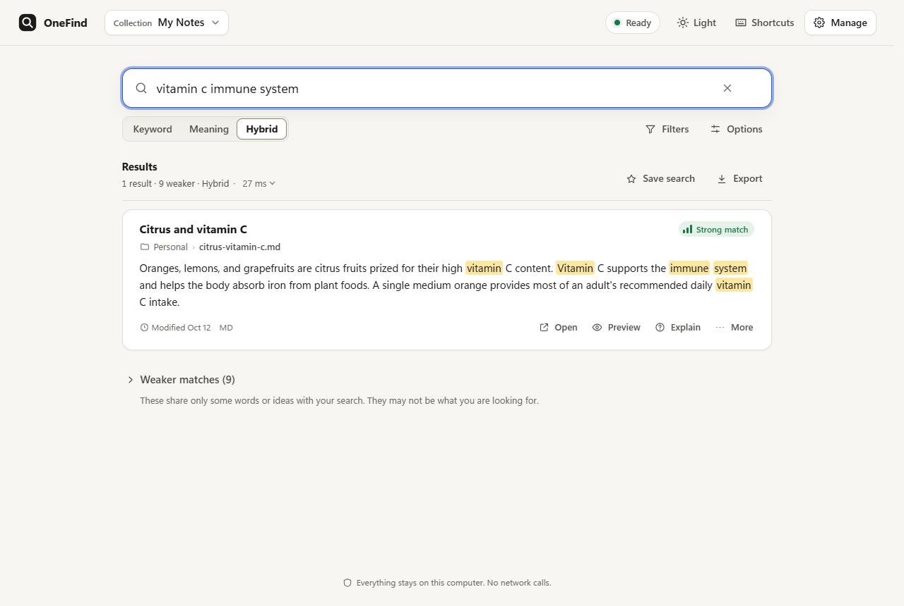
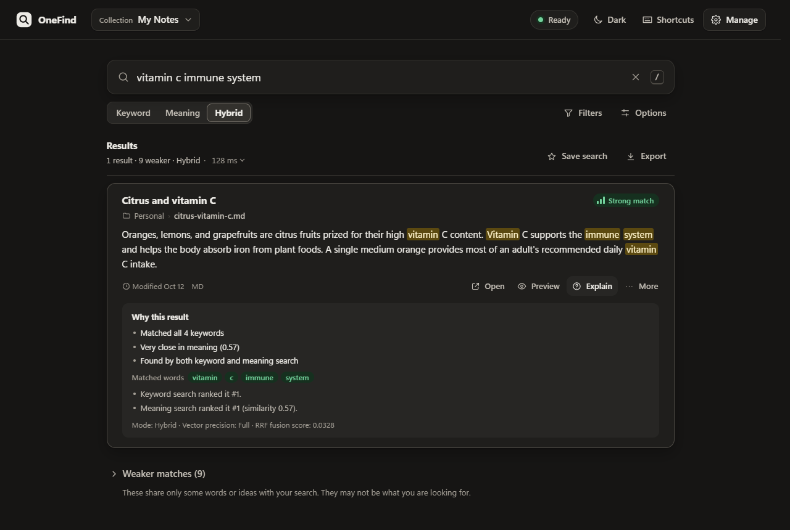
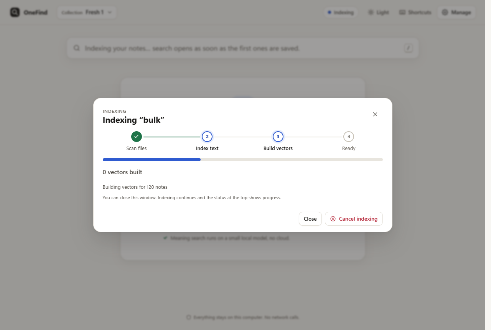
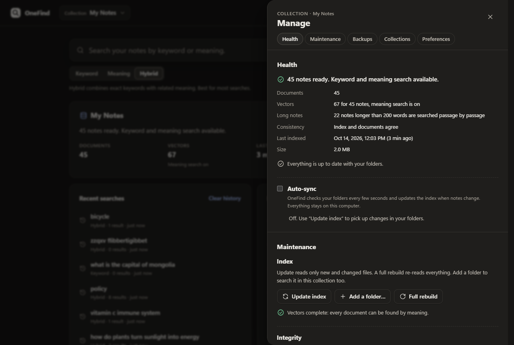

# OneFind: private search for your notes

**OneFind is a local search app for your notes and documents.** Point it at a folder of Markdown or
text files and it builds one index file that you can search by exact keyword, by meaning, or by
both at once (hybrid search). It runs in your browser on `127.0.0.1`. Your notes, queries and index
stay on your computer, and you don't need an account, a cloud service or a GPU.

Underneath the app is a research engine: a careful, test-backed reproduction of
**arXiv:2608.24060**, which puts SQLite FTS5 keyword search, sqlite-vec vector search, quantized
ranking and Reciprocal Rank Fusion into a single SQLite file. The benchmark evidence is in
[Under the hood](#under-the-hood-the-research-engine) below.

| Hybrid results | Why this result (dark) |
|---|---|
|  |  |
| **Indexing a folder** | **Manage: health, maintenance, backups (dark)** |
|  |  |

All 15 states in light and dark, at desktop and phone widths, are in
[`screenshots/v1.2/`](screenshots/v1.2/README.md).

---

## Contents

- [What it does](#what-it-does)
- [Two-minute quickstart](#two-minute-quickstart)
- [Collections, backups and moving to another computer](#collections-backups-and-moving-to-another-computer)
- [Privacy](#privacy)
- [Keyboard shortcuts](#keyboard-shortcuts)
- [CLI quick reference](#cli-quick-reference)
- [Honest limits](#honest-limits)
- [Testing](#testing)
- [Project structure](#project-structure)
- [Under the hood: the research engine](#under-the-hood-the-research-engine)

For a plain-language, task-by-task walkthrough, see the
**[User Guide](docs/12-user-guide.md)**.

---

## What it does

- **Three ways to search.** *Keyword* finds exact words, names and codes. *Meaning* finds notes
  about the same idea even when they use different words. *Hybrid* (the default) combines both.
- **Live results as you type.** Results are debounced, stale requests are cancelled, and a short
  staged progress line shows each step (understanding query → keyword → meaning → combining →
  preparing).
- **Honest results.** Each result gets a *Strong*, *Good* or *Weak* match label. Weak matches are
  grouped under "Weaker matches". When nothing fits well, OneFind says "No strong matches" rather
  than presenting a weak hit as the answer.
- **Why this result.** *Explain* shows the matched words, how keyword and meaning search each
  ranked the note, and the similarity score.
- **Filters** by folder, file type, modified date, and front-matter tags.
- **Act on results.** Open the file in its default app, show it in its folder, preview it with
  find-in-document, copy the snippet, bookmark it, or export the results as Markdown or JSON.
- **Pick up where you left off.** The home screen shows recent searches, saved searches (which keep
  their mode and filters), recently opened documents and bookmarks.
- **Collections.** Keep separate indexes such as "Notes", "Work" and "Project X", and switch
  between them from the header.
- **Maintenance built in.** Updates are incremental, so only new and changed files are read. You
  can also exclude patterns, remove deleted files, check integrity and repair, compact, back up,
  restore, and clear a collection, all with confirmations where it matters.
- **Comfortable to use.** Light and dark themes, full keyboard control, Reduce motion, screen-reader
  labels, and layouts down to 320 px wide.

Supported files: `.md`, `.markdown`, `.txt`, `.text`, `.rst`, `.org` (and `.jsonl` datasets
from the CLI). A leading YAML-style front-matter block can set `title:` and `tags:`.

---

## Two-minute quickstart

You need **Python 3.11+** and Git.

```bash
git clone https://github.com/WebDclassified/OneFind.git
cd OneFind
python -m venv .venv
```

```powershell
# Windows PowerShell
.\.venv\Scripts\Activate.ps1
```

```bash
# macOS / Linux
source .venv/bin/activate
```

Install the app with meaning search:

```bash
python -m pip install --upgrade pip
pip install -e ".[model,serve]"
```

(`pip install -e ".[serve]"` alone gives you keyword search only. Use `.[model,eval,serve,dev]`
for the full development stack.)

Start it:

```bash
onefind serve
```

Open **<http://127.0.0.1:8080/>**. On first launch the welcome screen offers **Index a folder**:

1. Choose a folder in the folder browser, or type its path.
2. Leave **Build vectors for meaning search** ticked (the first run downloads the small
   all-MiniLM-L6-v2 model once).
3. Watch the progress (*Scan files → Index text → Build vectors → Ready*), then choose **Start
   searching**.

With no `--db`, `onefind serve` runs in **library mode**. Your collections are listed in a
per-user library folder:

| OS | Library folder |
|---|---|
| Windows | `%APPDATA%\OneFind` |
| macOS | `~/Library/Application Support/OneFind` |
| Linux | `$XDG_DATA_HOME/onefind` or `~/.local/share/onefind` |

Set `ONEFIND_HOME` (or `serve --home DIR`) to use a different library folder. `onefind serve --db
my.db` still serves a single file, as in v1.1.

**Want a demo corpus first?** The repository ships 20 cross-domain sample notes:

```bash
onefind index ./sample-data --collection Sample --embed
onefind serve
```

---

## Collections, backups and moving to another computer

**A collection is one SQLite file** (`.db`). It contains the search index and the text of your
documents, plus your search history, saved searches, bookmarks and the list of folders it indexes.
It does **not** contain your original files, so OneFind never moves, edits or deletes your notes.

| Task | In the app | From the terminal |
|---|---|---|
| Create / switch | Header → collection switcher → *New collection…* | `onefind collections create Work` / `onefind collections use Work` |
| Add a folder | *Index a folder*, or Manage → Maintenance → *Add a folder…* | `onefind index ~/Notes --collection Work --embed` |
| Pick up changes | Manage → Health → *Update index* | `onefind index ~/Notes --collection Work --prune` |
| Back up | Manage → Backups → *Back up now* | `onefind backup --collection Work` |
| Restore | Manage → Backups → *Restore…* → *Restore as a new collection* or *Replace current…* | `onefind restore BACKUP.db --as "Work restored"` |
| Open a moved file | Collection switcher → *Open existing collection file…* | `onefind collections create Work --db ~/Moved/work.db` |

Backups use SQLite's online backup API, so they are safe to take while OneFind is running. They go
to the library's `backups/` folder as `<collection>-YYYYmmdd-HHMMSS.db`. **Replace current** asks
you to type the collection name and makes a safety backup first. **Restore as a new collection**
leaves your current collection untouched.

**Moving to another computer:** make a backup (or copy the `.db` while OneFind is closed), copy it
across, and on the new machine choose **Open existing collection file…** (or `onefind collections
create NAME --db PATH`). Search and preview work straight away, because the text travels inside the
file. *Open* and *Show in folder* need the original notes folder at the same path. Re-index from
the folder's new location to update paths.

---

## Privacy

- Your notes, queries, search history and index **never leave your computer**. OneFind has no
  telemetry, no accounts, and no hosted search or embedding API. The frontend loads no CDN, web
  font or analytics script, and a strict Content-Security-Policy blocks inline and third-party
  scripts.
- Meaning search runs on a small open model (`sentence-transformers/all-MiniLM-L6-v2`) **on your
  CPU**. The model is downloaded once from Hugging Face the first time you build vectors. After
  that it loads from the local cache with no network requests (set `HF_HUB_OFFLINE=1` as well if
  you want the Hugging Face libraries themselves to refuse any network access).
- The server binds to `127.0.0.1` only. A non-loopback bind is refused unless you pass
  `--allow-remote`. The app has no login, so only do that behind a trusted firewall or an
  authenticated proxy. Opening and revealing files works only for loopback requests, only for
  files inside a folder you indexed, and can be turned off with `--no-open`.
- Every state-changing endpoint added in v1.2 (indexing, collections, backups, maintenance,
  bookmarks and so on) requires an `X-OneFind-Request: 1` header, which guards against cross-site
  requests. Indexed text is always rendered as text, never as HTML.

---

## Keyboard shortcuts

| Key | Action |
|---|---|
| `/` or `Ctrl`+`K` (`Cmd`+`K`) | Focus the search box |
| `Enter` in the search box | Search now (otherwise results update as you type) |
| `↓` `↑` or `j` `k` | Move between results |
| `Home` / `End` | First / last result |
| `Enter` on a result | Preview the document |
| `o` | Open the file |
| `c` | Copy the snippet |
| `b` | Bookmark / remove bookmark |
| `e` | Explain why it matched |
| `Esc` | Close the preview, then clear the search |
| `?` | Show the shortcuts list |

You can turn off single-key shortcuts in **Manage → Preferences** if they get in the way of speech
input or other tools.

---

## CLI quick reference

The command is lowercase `onefind` on every OS (or `python -m onefind.cli`). Exit codes: `0`
success, `2` usage error, `3` environment problem, `4` data error, `130` cancelled.

**Which collection does a command use?** `--db PATH` wins, then `--collection NAME`, then
`./onefind.db`. Read and maintenance commands (`search`, `status`, `doctor`, `compact`, `backup`,
`remove`) fall back to the library's **active** collection when there is no `./onefind.db`.

| Command | What it does |
|---|---|
| `onefind check [--full] [--json]` | Verify Python, SQLite FTS5, sqlite-vec and (with `--full`) load the model |
| `onefind serve [--db FILE] [--home DIR] [--port 8080] [--no-open] [--allow-remote]` | Run the web app (library mode without `--db`) |
| `onefind index PATH [--collection NAME] [--embed] [--exclude PATTERN]… [--prune] [--full] [-q]` | Index or update a folder (incremental; exclusions are remembered per folder) |
| `onefind search QUERY [--mode lexical\|semantic\|hybrid] [--k N] [--folder F] [--type md] [--tag T] [--since YYYY-MM-DD] [--explain]` | Search from the terminal |
| `onefind status [--no-scan] [--json]` | Health, changed files per folder, and the last indexing run |
| `onefind collections list [--json]` | List collections (`*` = active) |
| `onefind collections create NAME [--db FILE]` | New collection, or register an existing `.db` |
| `onefind collections use NAME` | Make a collection active |
| `onefind collections rename NAME NEW_NAME` | Rename (the file keeps its name) |
| `onefind collections remove NAME [--delete-file --yes]` | Forget a collection (file kept unless `--delete-file --yes`) |
| `onefind backup [--out FILE\|DIR] [--overwrite]` / `onefind backup --list` | Write or list single-file backups |
| `onefind restore BACKUP --as NAME` | Restore a backup as a new collection |
| `onefind doctor [--repair]` | Integrity check; `--repair` rebuilds the keyword index, drops leftovers, re-embeds missing vectors |
| `onefind compact` | Reclaim unused space in the collection file |
| `onefind remove DOC_ID…` | Remove notes from the index (files on disk are untouched) |
| `onefind eval DATASET` | Build and evaluate a BEIR dataset (research) |
| `onefind sweep-alpha DATASET --db FILE` | Compare linear fusion weights against RRF (research) |
| `onefind smoke --db FILE [--queries FILE]` | Run JSONL gold queries against an index |

Advanced search flags: `--precision float|int8|binary`, `--rerank`, `--candidate-depth N`,
`--fusion rrf|linear`, `--alpha A`, `--rrf-k K`. Run `onefind <command> --help` for details.
[HOW_TO_RUN.md](HOW_TO_RUN.md) has worked examples.

---

## Honest limits

OneFind is designed for **personal and small-team collections on one computer**.

- **Size.** Up to about **5,000 notes** is the sweet spot. **5,000 to 50,000** is fine: search
  stays quick, but full rebuilds and building vectors take minutes. **Above about 50,000** is
  beyond its comfort zone. Keyword search stays fast, but filtered, int8 and binary meaning
  searches scan every vector. Manage → Health says when you cross these lines. Measured hybrid p95
  latency is about **175 to 220 ms** on 3.6k to 5.2k-document BEIR corpora on a laptop CPU (see
  below).
- **One vector per note.** Each note is embedded as a whole and the model reads roughly its first
  256 tokens, so meaning search represents long notes by their opening. Keyword search covers the
  full text.
- **Plain text only.** No PDF, Word, HTML or OCR. Files over 5 MB, binary files and empty files are
  skipped and listed as skipped after indexing.
- **English-first model.** all-MiniLM-L6-v2 is trained mainly on English. Keyword search works for
  any language that FTS5's `unicode61` tokenizer can split.
- **Single user, local only.** No accounts, sharing, sync or live folder watching. Run *Update
  index* (or `onefind index … --prune`) to pick up changes, and Manage → Health tells you when
  folders have changed.
- **Quantized speed.** int8 and binary match float quality closely, but this implementation does
  **not** reproduce the paper's quantized speed advantage (details below).

---

## Testing

```bash
pip install -e ".[model,eval,serve,dev]"
pytest
```

More than 700 tests cover storage and the v2→v3 migration, ingestion, snippets, search quality and
calibration, the collection library, background jobs, the HTTP API, the CLI, and static UI
contracts. Fake embedders cover edge cases, and a small real-MiniLM suite covers integration. The
model-free subset that CI runs is listed in `.github/workflows/ci.yml`.

**Live UI walkthrough.** `tools/ui_check.py` starts a real `onefind serve --no-open` against a
scratch library (`ONEFIND_HOME=<scratch>/home`) and drives an installed Chrome with Playwright
through onboarding, indexing, every search state, filters, preview, Explain, saved searches,
bookmarks, collections, backups and restore, maintenance, keyboard use, themes, reduced motion and
five window widths. It asserts more than 300 checks and saves screenshots:

```bash
pip install -e ".[browser]"
python tools/ui_check.py                              # scratch folder defaults to <temp>/onefind-ui, port 8765
python tools/ui_check.py --release screenshots/v1.2   # also regenerate the release screenshot set
```

It uses an existing Chrome (`--chrome PATH` or `ONEFIND_CHROME` if it is not auto-detected) and
never downloads a browser. Exit status `0` means every check passed.

---

## Project structure

| Path | Purpose |
|---|---|
| `src/onefind/store.py` | One-file SQLite store (schema v3): documents, FTS5, vectors, history, saved searches, bookmarks, runs, backup/integrity/repair/compact |
| `src/onefind/ingest.py` | Folder/file/JSONL ingestion, front matter, excludes, incremental hashing, pruning, change scan |
| `src/onefind/search.py` | Keyword, semantic and hybrid retrieval, filters, explain, confidence, stages |
| `src/onefind/snippets.py` | Passage selection and safe highlight segments |
| `src/onefind/library.py` | Named-collections registry (`collections.json`) and backup locations |
| `src/onefind/jobs.py` | Background indexing jobs and the shared model cache |
| `src/onefind/serve.py` | FastAPI app: JSON + NDJSON streaming API, CSRF guard, static assets |
| `src/onefind/cli.py` | The `onefind` command |
| `src/onefind/embed.py`, `envcheck.py`, `errors.py` | Model wrapper, environment check, typed errors |
| `src/onefind/evaluate.py`, `datasets.py` | BEIR evaluation harness and dataset download |
| `src/onefind/static/` | No-build web app (vanilla ES modules, CSS, SVG), packaged in the wheel |
| `tests/` | Unit, integration, API, CLI and UI-contract tests |
| `tools/ui_check.py` | Live browser walkthrough and release screenshots |
| `tools/browser_check.py` | v1.1 browser evidence runner (`sshot/`) |
| `sample-data/` | 20 sample notes and 26 gold queries |
| `screenshots/v1.2/` | Release screenshots (light/dark × 1280/375) |
| `benchmarks/reports/` | Evaluation and extension reports |
| `docs/` | Product spec (10), implementation contract (11), [user guide (12)](docs/12-user-guide.md), and the original design docs (01–09) |
| `HOW_TO_RUN.md` | Detailed setup, CLI recipes, evaluation reproduction |
| `CHANGELOG.md` | Release notes |
| `FORMAL_PROJECT_REPORT.md`, `REPORT.md` | Academic reports with historical context |

---

## Under the hood: the research engine

OneFind began as a from-scratch reproduction of **arXiv:2608.24060**: lexical, semantic and hybrid
search in one SQLite file. The app above runs on that same engine, unchanged in ranking.

### Architecture

```text
web app (static ES modules)  ·  onefind CLI  ·  evaluation harness
                 │                   │
         FastAPI (loopback) ─── background jobs + model cache
                 │
                 ▼
       onefind.search dispatcher ── filters · explain · confidence
        ┌────────┼──────────┐
        ▼        ▼          ▼
     FTS5 BM25  vector KNN  hybrid RRF / linear (+ optional rerank)
        │        │          │
        └────────┴────┬─────┘
                      ▼
               one SQLite file
   documents · chunks · FTS · vectors · manifest
   roots · history · saved · bookmarks · activity · runs
```

### Retrieval paths

- **Keyword:** SQLite FTS5/BM25, strongest match first. The app uses "auto" matching: notes with
  all your words come first, topped up with partial matches when there are too few, and it says so.
- **Semantic float:** native sqlite-vec cosine KNN over normalized float32 vectors.
- **Semantic int8:** globally scaled 8-bit cosine ranking in bounded blocks.
- **Semantic binary:** sign-bit Hamming ranking in bounded blocks.
- **Hybrid:** RRF by default. Linear normalization is available for research comparisons.
- **Rerank:** one query encoding, cosine scoring of the full fused pool, and refreshed output
  scores.
- **Filters** restrict both legs before ranking. Semantic search with filters uses an exact scan
  of the allowed rows and never post-filters a top-k, which would lose results.
- Ordering is deterministic (score descending, then `doc_id` ascending).

### Sample retrieval corpus

`sample-data/` holds 20 short documents covering plant biology, nutrition, exercise, fermentation,
intertidal ecology, bicycle mechanics, sleep, composting, clouds, music theory, captioning,
corrosion, geometry, library operations, personal finance, vector search and ceramics. It also has
two same-stem documents in different folders to test identity safety.
`sample-data/queries.jsonl` provides 26 cases (25 answerable, one no-answer). The current local run
achieves **1.000 Hit@3, 1.000 MRR@5 and 1.000 no-answer accuracy**:

```bash
onefind index ./sample-data --db demo.db --embed
onefind smoke --db demo.db --queries sample-data/queries.jsonl
```

### Corrected benchmark evidence (full runs, 2026-09-24)

| Configuration | SciFact nDCG@10 | NFCorpus nDCG@10 |
|---|---:|---:|
| lexical BM25 | 0.0467 | 0.2073 |
| semantic float | 0.6451 | 0.3167 |
| semantic int8 | 0.6465 | 0.3160 |
| semantic binary | 0.5827 | 0.2761 |
| hybrid float (RRF) | **0.6568** | **0.3466** |
| hybrid int8 (RRF) | **0.6582** | 0.3465 |
| hybrid binary (RRF) | 0.5959 | 0.3169 |
| hybrid float + cosine rerank | 0.6451 | 0.3167 |

What the corrected evidence says:

- Hybrid float beats the best single mode on both datasets: +0.0117 on SciFact and +0.0299 on
  NFCorpus.
- Int8 stays extremely close to float quality, but the exact bounded scan is much slower. This
  implementation does **not** reproduce the paper's quantized speed advantage.
- Binary loses quality and is still slower than native float KNN. Its value is as a configuration
  study, not a performance win.
- Pure-cosine reranking hurts both datasets once the deeper 100-document fused pool is rescored.
  RRF remains the safer default.
- The original ≤150 ms p95 goal is not met by vector modes on this CPU. Float-hybrid p95 is
  174.8 ms on SciFact and 218.3 ms on NFCorpus.
- The linear alpha sweep is effectively tied with RRF (SciFact α=0.1: 0.6572 vs 0.6568; NFCorpus
  α=0.2: 0.3470 vs 0.3466). A 0.0004 single-run difference is not evidence of superiority.

Full provenance-rich reports:
[`eval-scifact-2026-09-24.md`](benchmarks/reports/eval-scifact-2026-09-24.md) ·
[`eval-nfcorpus-2026-09-24.md`](benchmarks/reports/eval-nfcorpus-2026-09-24.md) ·
[`alpha-sweep-scifact-2026-09-24.md`](benchmarks/reports/alpha-sweep-scifact-2026-09-24.md) ·
[`alpha-sweep-nfcorpus-2026-09-24.md`](benchmarks/reports/alpha-sweep-nfcorpus-2026-09-24.md).
They record dataset hashes, selected IDs, package versions, code state and database health. The
model revision is recorded honestly as `unpinned`. These are single-run measurements, not
confidence intervals. The historical `2026-08-26` reports are kept for transparency but are not
valid evidence: that prototype reversed BM25 ordering, and its reranking kept stale fusion scores.

Regenerate:

```bash
onefind eval scifact --db data/scifact.db
onefind eval nfcorpus --db data/nfcorpus.db
onefind sweep-alpha scifact --db data/scifact.db
onefind sweep-alpha nfcorpus --db data/nfcorpus.db
```

### Data integrity and safety

- Writes to documents, FTS, chunks and vectors are transactional, in committed batches. A failed
  or cancelled indexing run keeps what was already committed and leaves the previous state
  searchable.
- Document IDs are collision-safe relative paths. When two indexed folders share a file name, the
  second one gets a root-qualified ID instead of overwriting the first.
- Schema v2 databases open and migrate to v3 in place, in one transaction. Unknown versions are
  refused.
- Embedded indexes reject keyword-only updates that would leave vectors stale. Attaching a model
  later backfills missing vectors. Encoder output shape, finite values and zero vectors are
  validated.
- Evaluation databases are built in temporary files, bound to a manifest (dataset hashes, IDs,
  model, configuration), and published atomically.
- Destructive actions (delete a collection file, replace from backup, clear) require typing the
  collection name. Replace makes a safety backup first. `/api/reset` stays disabled unless
  `--reset-token` is given.

### v1.1 browser evidence

[`sshot/`](sshot/) holds the 21 Playwright screenshots and machine-readable assertions from the
v1.1 UI (`python tools/browser_check.py --output sshot`). The v1.2 app is covered by
`tools/ui_check.py` and [`screenshots/v1.2/`](screenshots/v1.2/README.md).

---

## Free and local by design

Python, SQLite, FTS5, sqlite-vec, NumPy, open-source sentence-transformers, FastAPI and vanilla
browser APIs. There are no paid APIs, hosted vector databases or recurring costs. The model and
datasets download once and are cached locally.

## License

MIT. See [`LICENSE`](LICENSE). Release notes are in [`CHANGELOG.md`](CHANGELOG.md).
